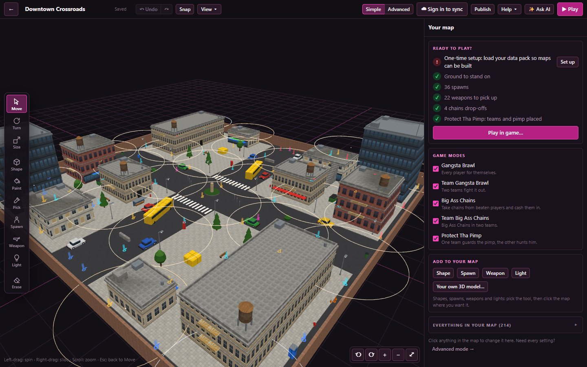
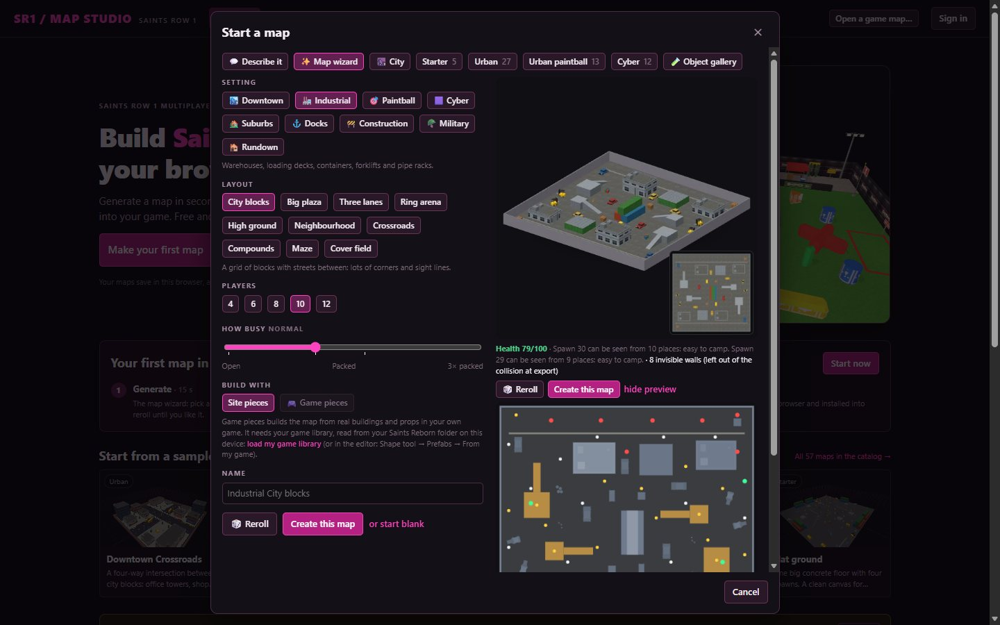
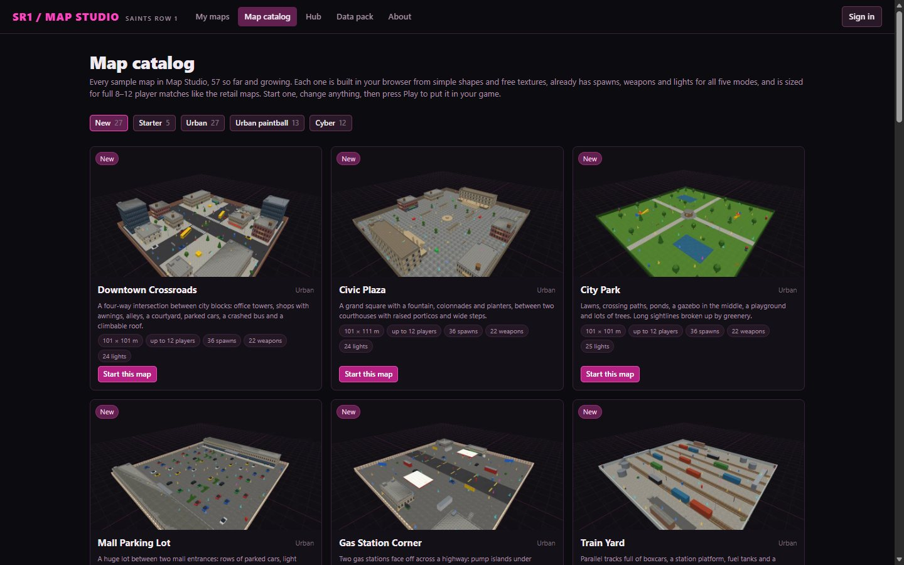
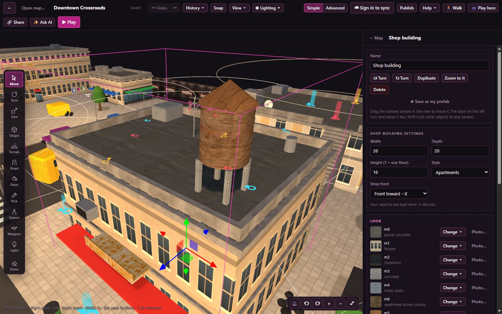
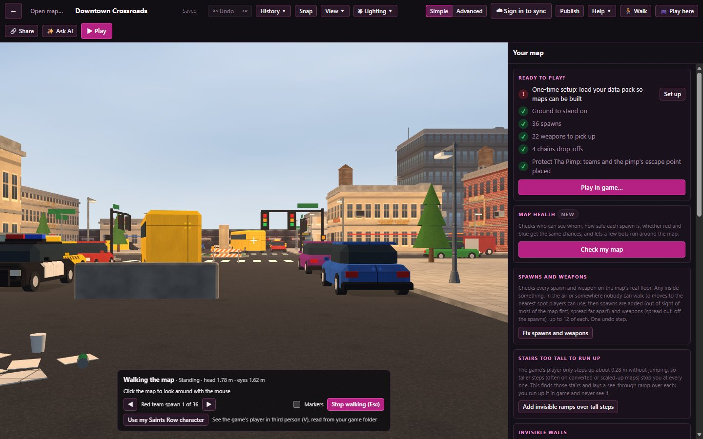
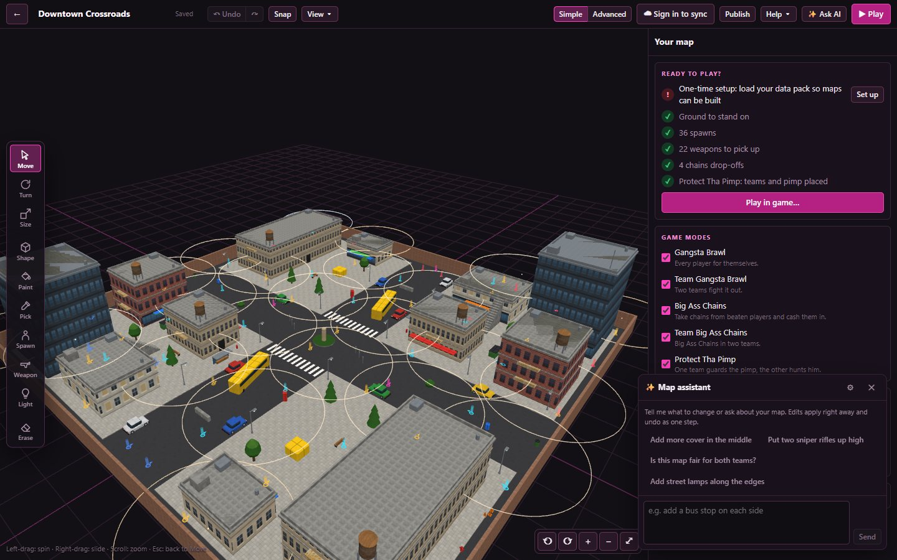
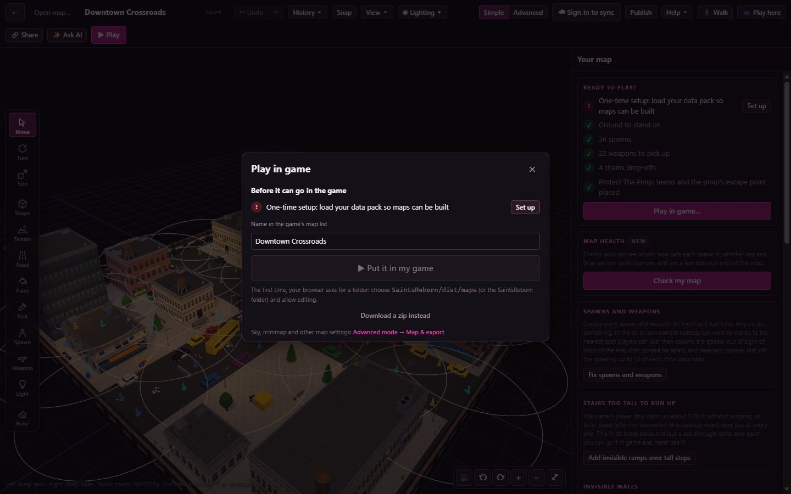

# SR1 Map Studio

**Build Saints Row 1 multiplayer maps in your browser, then play them in Saints Reborn.**

### ▶ [sr1-mapstudio.netlify.app](https://sr1-mapstudio.netlify.app)

Nothing to install. Open the site, start a map, press **Play**.

## Start a map in seconds

**Map wizard.** Pick one of nine settings (downtown, industrial, suburbs, docks, construction,
military, rundown, paintball or cyber), one of ten layouts (city blocks, a big plaza, three lanes, a
ring arena, high ground, a neighbourhood, crossroads, compounds, a maze or a cover field), how many
players and how busy you want it.
You see the map from above before you build it. Don't like it? Press **Reroll** for a new one.
Every map comes out fair: both teams get the same layout, turned around.

**Map catalog.** 57 ready-made maps across four themes: city streets, parks, docks, train
yards, paintball fields, neon arenas and more. Each one is sized like the retail Gangsta Brawl and
Big Ass Chains maps (8–12 players), with plenty of spawns, weapons scattered everywhere, chains
drop-offs and lights already placed. Start one and change anything.

## Build it your way

- **Click to place.** Floors, walls, ramps, stairs, pillars and roofs, or about 670 ready-made pieces:
  buildings, cars, buses, trees, ponds, street lamps, bus stops, paintball bunkers, containers,
  forklifts, neon pillars, jump pads and more.
- **Rooms you can walk into.** Shops, bars, offices, apartments, garages, a warehouse with a
  mezzanine, two-storey buildings with stairs, and furniture to fill them: tables, couches, pool
  tables, arcade machines, lockers, shelves.
- **Change any piece after placing it.** Make a building taller, switch it from shops to offices,
  repaint a car. It rebuilds in place.
- **Paint with real textures.** Brick, concrete, asphalt, metal, grass, water, neon grids, falling
  green code, or a photo you take with your phone.
- **Make things from photos.** Snap a shop front and it becomes a building; snap a sign and it
  becomes a cut-out with the background removed.
- **Tag the walls.** Write graffiti in spray, bubble, stencil or marker style, or stick on any
  picture, then click a wall to put it there.
- **Pick several things at once** (Shift+click), move and turn them together, group them, copy
  and paste them, even into another map.
- **Save your own pieces.** Built a street corner you like? Save it as *My prefab* and drop it into
  any map.
- **Physics props.** Pick any object or model and make it a light crate, something heavy, a tire
  that rolls, a bouncy ball, a propane tank that explodes or a prop that breaks. Its collision is
  fitted to the model (box, ball, cylinder, wrapped or separate parts). Ready-made sets: a crate
  tower, a tire ramp, a propane chain reaction and bowling pins.

## Walk it before you play it

Press **🚶 Walk** to drop into your map at player height, starting on a spawn. Walk, run and jump,
climb the stairs and ramps, and check every sight line before you export. Press **V** to see your
player from behind. The **free camera** works like the desktop editor: hold the right mouse button
to look around and fly with WASD.

Physics props come alive while you walk: shoot them (click), blow them up (right-click or **G**),
kick them (**F**) or walk into them, and **T** puts them back. It's a rough preview; the game uses
its own physics.

## Play it in the browser, share it by link

Press **🎮 Play here** to play the map right in the browser: walk over weapon pickups to grab
them, and race the clock to collect every weapon or touch every Chains drop-off, with a minimap
in the corner. On a phone, a thumb stick and buttons appear. Press **🔗 Share** for a link anyone
can open to play it too, with no game and no account. Links carry only the site's own generated
and starter-library textures (never your pictures, never game files), so if your map uses your own
images, Share tells you which and can swap them for a plain texture.

## Just say what you want

The **map assistant** lets you describe changes in plain words: *"add more cover in the middle"*,
*"put two sniper rifles up high"*, *"is this map fair for both teams?"*. It makes the edits for you,
and one click undoes them. It runs on NVIDIA's free AI models with your own free key from
[build.nvidia.com](https://build.nvidia.com).

## Ready to play

A checklist on the side tells you what the map still needs: ground to stand on, spawns, weapons,
everything each game mode needs. When it's all green, press **Play**. Your map gets its own
minimap, drawn from above, and goes straight into your Saints Reborn maps folder in Chrome or Edge (or download it as
a zip to share).

Every map supports **Gangsta Brawl**, **Team Gangsta Brawl**, **Big Ass Chains**, **Team Big Ass
Chains** and **Protect Tha Pimp**. Place team cars, garages, a chop shop and a victory garage to add
**Blinged Out Ride** (new, not yet tried in game). Sound zones play the game's own ambience sounds
where you put them, and wooden crates can smash into boards, both read from your own game files.

## Good to know

- **One-time setup.** Building a map needs the template files from your own copy of the SR1 Map
  Studio package. The site walks you through loading them once; they stay in your browser.
- **Your game files never leave your computer.** The site never hosts or uploads Saints Row files.
- **Your maps save automatically** in your browser. Sign in to keep them in the cloud and open them
  on another device.
- **Bring your own models.** Import OBJ, GLB, glTF or FBX from Blender or any 3D app.
- **Simple or Advanced.** Simple mode keeps things easy; Advanced shows every setting (glass and
  breakables, movable props, collision, sky, weather and more).

---

## Credits

SR1 Map Studio was created by **Kewizzle**, who came up with the idea and built the original desktop
program and map exporter this project started from.

**[00xJS](https://github.com/00xJS)** rebuilt it from the ground up as this web app and took it much
further, working out more of how the game builds its maps along the way: the browser editor,
walk-through and free cam, the map wizard and AI chat, real Stilwater buildings and props from your
own game, Stilwater cuts, in-place upgrades for finished maps (the game's sky, a minimap, retail
lighting), working minimaps, removal of invisible walls, invisible ramps over stairs and kerbs too
tall to walk up, the map health check (campable spawns, sight lines by weapon reach, fairness,
spawns and guns players can't reach, falls, a bot playtest, texture memory), hundreds of objects,
cloud saves, share links and the Showcase, and the new export features (game modes, water,
breakables, lighting, the game's own sky).

The map-format code comes from the Saints Reborn Map Converter by **whompay**.

Free and open source under GPL-3.0-or-later. Working on the code? See
[docs/DEVELOPING.md](docs/DEVELOPING.md).
